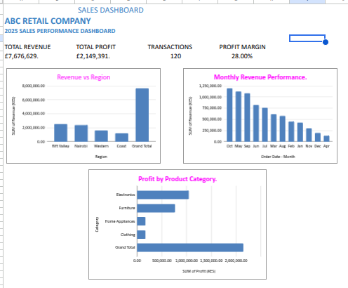
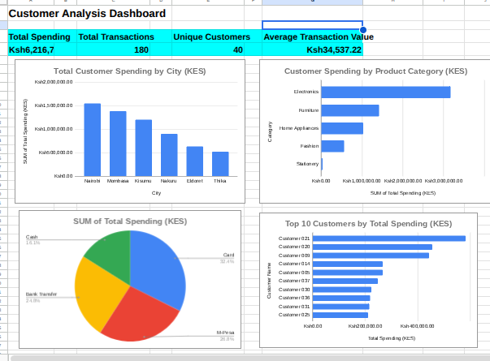
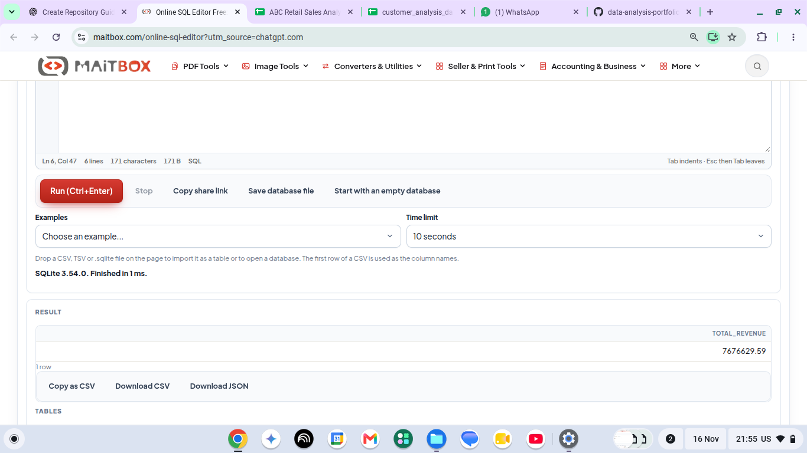

# Data Analyst Portfolio

Welcome to my Data Analytics Portfolio!

I am an aspiring Data Analyst building practical skills in data analysis, data cleaning, data visualisation and business intelligence.

I work with **Microsoft Excel, Google Sheets and SQL** to analyse datasets, identify trends, create dashboards and generate meaningful business insights.

## About Me
I enjoy working with data to solve business problems and support informed decision-making. Through practical projects, I am developing my ability to transform raw data into clear reports, visualisations and actionable insights.

This portfolio showcases my hands-on projects, analytical skills and continuous learning journey.

## Technical Skills & Tools

- Microsoft Excel
- Google Sheets
- SQL (SQLite)
- Data Cleaning
- Data Analysis
- Pivot Tables
- Data Visualisation
- Dashboard Creation
- Business Insights

## Featured Projects

### 1. ABC Retail Sales Analysis
Analysed retail sales data to identify revenue trends, product performance, regional performance, and profitability.

**Tools:** Google Sheets, Pivot Tables, Charts and Dashboards.

[View Project](projects/sales-data-analysis/)

### 2. Customer Analysis Dashboard
Analysed customer purchasing behaviour to identify top-spending customers, cities, product categories, and payment methods.

**Tools:** Google Sheets, Pivot Tables, Charts and Dashboards.

[View Project](customer-analysis-dashboard/)

## Project 3: Retail Sales Analysis Using SQL

**Description:** Analysed 120 retail sales transactions using SQL (SQLite) to identify revenue trends, product performance, regional performance, and business opportunities.

**Tools:** SQL, SQLite, Online SQL Editor

**Key Findings:**
- Total Revenue: KES 7,676,629.59
- Total Profit: KES 2,149,391.64
- Profit Margin: 28%
- Top Revenue Region: Rift Valley
- Top Revenue Product: Laptop
- Top Payment Method: M-Pesa

**Project Files:** [View SQL Retail Sales Analysis](projects/retail-sales-sql-analysis/)
## SQL Analysis Results

### Total Revenue

The SQL query calculated total retail sales revenue of KES 7,676,629.59.

## Career Goal

My goal is to grow as a Data Analyst by working on real-world datasets, developing my technical skills and delivering data-driven insights that help businesses make better decisions.

I am open to learning opportunities, internships and entry-level Data Analyst opportunities.

## Contact

- **GitHub:** [vitalisrajv](https://github.com/vitalisrajv)

---

Thank you for visiting my portfolio!
