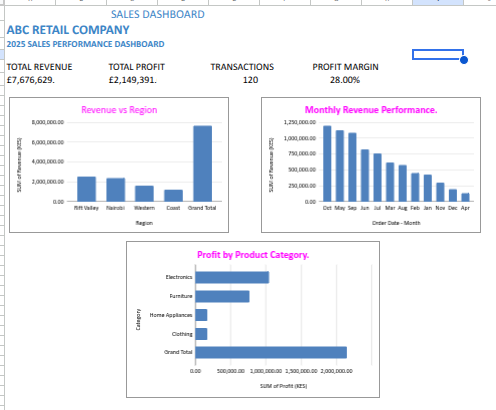

# Retail Sales Data Analysis – ABC Retail Company

## Project Overview
This project analyses fictional retail sales data for ABC Retail Company covering the year 2025. The purpose is to identify sales trends, profitable products, and high-performing regions using Google Sheets.

## Project Objectives
- Calculate total revenue, total cost, and total profit.
- Identify the highest-revenue product.
- Identify the best-performing region.
- Determine the highest-sales month.
- Identify the most profitable product category.
- Present findings using a sales dashboard.

## Tools Used
- Google Sheets
- Pivot Tables
- Spreadsheet formulas
- Charts and data visualisation
- GitHub

## Key Findings

| Business Metric | Result |
|---|---:|
| Total Revenue | KES 7,676,629.59 |
| Total Cost | KES 5,527,237.95 |
| Total Profit | KES 2,149,391.64 |
| Total Transactions | 120 |
| Average Order Value | KES 63,971.91 |
| Profit Margin | 28% |

## Business Insights

1. **Top Product:** Laptop generated the highest revenue at KES 2,388,878.67.
2. **Top Region:** Rift Valley generated the highest revenue at KES 2,520,571.20.
3. **Best Sales Month:** October generated KES 1,193,429.91 in revenue.
4. **Most Profitable Category:** Electronics generated KES 1,041,012.51 in profit.

## Data Cleaning
- Checked for missing values.
- Checked for duplicate Order IDs.
- Checked for invalid sales quantities.
- Checked product prices and costs.
- Verified Revenue, Total Cost, and Profit formulas.

All checks performed returned zero issues.

## Dashboard
The project includes:
- Total Revenue KPI
- Total Profit KPI
- Transaction Count KPI
- Profit Margin KPI
- Revenue by Region chart
- Monthly Revenue chart
- Profit by Product Category chart

## Project Files
- `retail_sales_dataset.csv` – Original sales dataset.
- `retail_sales_analysis_starter.xlsx` – Original Excel starter workbook.
- `ABC_Retail_Sales_Analysis_Completed.xlsx` – Completed analysis workbook.
- - `sales_dashboard.png` – Screenshot of the completed sales dashboard.

## Conclusion
The analysis identified laptops as the highest-revenue product, Rift Valley as the strongest region, and Electronics as the most profitable category. These findings can help ABC Retail Company make better sales and inventory decisions.

## Author
**GitHub:** # Retail Sales Data Analysis – ABC Retail Company

## Project Overview
This project analyses fictional retail sales data for ABC Retail Company covering the year 2025. The purpose is to identify sales trends, profitable products, and high-performing regions using Google Sheets.

## Project Objectives
- Calculate total revenue, total cost, and total profit.
- Identify the highest-revenue product.
- Identify the best-performing region.
- Determine the highest-sales month.
- Identify the most profitable product category.
- Present findings using a sales dashboard.

## Tools Used
- Google Sheets
- Pivot Tables
- Spreadsheet formulas
- Charts and data visualisation
- GitHub

## Key Findings

| Business Metric | Result |
|---|---:|
| Total Revenue | KES 7,676,629.59 |
| Total Cost | KES 5,527,237.95 |
| Total Profit | KES 2,149,391.64 |
| Total Transactions | 120 |
| Average Order Value | KES 63,971.91 |
| Profit Margin | 28% |

## Business Insights

1. **Top Product:** Laptop generated the highest revenue at KES 2,388,878.67.
2. **Top Region:** Rift Valley generated the highest revenue at KES 2,520,571.20.
3. **Best Sales Month:** October generated KES 1,193,429.91 in revenue.
4. **Most Profitable Category:** Electronics generated KES 1,041,012.51 in profit.

## Data Cleaning
- Checked for missing values.
- Checked for duplicate Order IDs.
- Checked for invalid sales quantities.
- Checked product prices and costs.
- Verified Revenue, Total Cost, and Profit formulas.

All checks performed returned zero issues.

## Dashboard
The project includes:
- Total Revenue KPI
- Total Profit KPI
- Transaction Count KPI
- Profit Margin KPI
- Revenue by Region chart
- Monthly Revenue chart
- Profit by Product Category chart

## Project Files
- `retail_sales_dataset.csv` – Original sales dataset.
- `retail_sales_analysis_starter.xlsx` – Original Excel starter workbook.
- `ABC_Retail_Sales_Analysis_Completed.xlsx` – Completed analysis workbook.

## Conclusion
The analysis identified laptops as the highest-revenue product, Rift Valley as the strongest region, and Electronics as the most profitable category. These findings can help ABC Retail Company make better sales and inventory decisions.
## Sales Dashboard

## Author
**GitHub:** [Vitalis Rajv](https://github.com/vitalisrajv)
